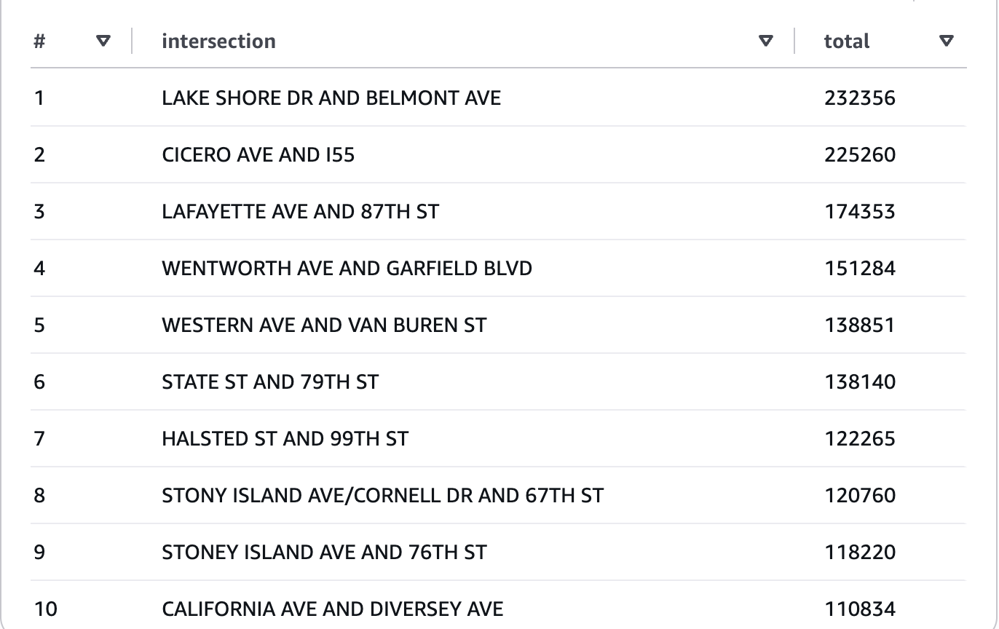

# Chicago Traffic Camera Analysis on AWS (S3 + Athena)

Exported a relational SQLite database of Chicago red-light and speed camera data to CSV, stored it in Amazon S3, and queried it with SQL in Amazon Athena.

## Workflow
1. Exported five tables from SQLite to CSV using the `sqlite3` CLI.
2. Uploaded each CSV to its own folder in an S3 bucket.
3. Created an Athena database and external tables over the S3 folders (OpenCSVSerde, header row skipped).
4. Ran SQL queries (joins, aggregation) directly on the data in S3.

## Example query
Top 10 intersections by total red-light violations:

```sql
SELECT i.intersection,
       SUM(CAST(v.num_violations AS integer)) AS total
FROM redviolations v
JOIN redcameras c ON v.camera_id = c.camera_id
JOIN intersections i ON c.intersection_id = i.intersection_id
GROUP BY i.intersection
ORDER BY total DESC
LIMIT 10;
```

## Result


## Tools
Amazon S3, Amazon Athena, SQL, SQLite
